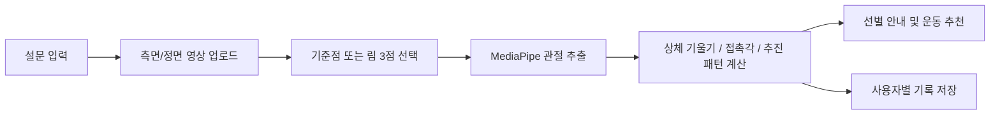
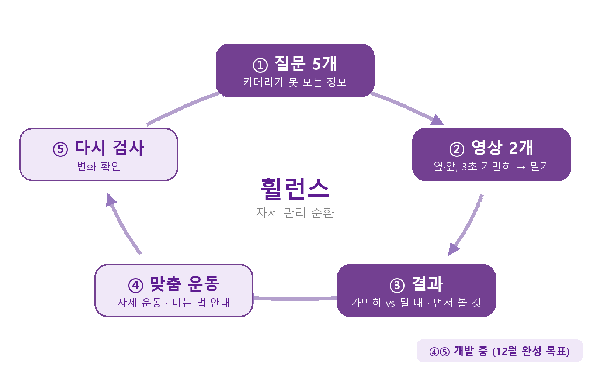
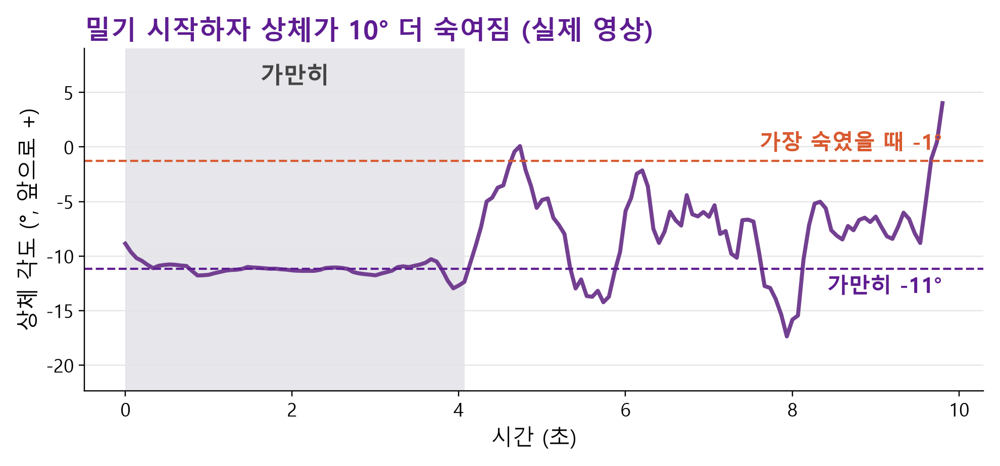
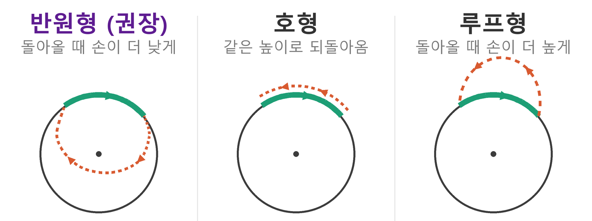

# Wheelance (휠런스)

앉은 자세와 휠체어 밀기 동작을 함께 확인하는 모바일 웹앱입니다.
영상에서 상체 자세와 바퀴 추진 패턴을 분석하고, 사용자가 확인할 수 있는 운동과 참고 정보를 제공합니다.

> Wheelance는 의료 진단 도구가 아니며, 대학 과제용 프로토타입입니다.
> 분석 결과는 전문 의료진의 평가를 대신할 수 없습니다.

[](https://www.python.org/)
[](https://streamlit.io/)
[](https://firebase.google.com/)

## 데모 및 시연 자료

- Streamlit Community Cloud 배포 URL은 Firebase 설정과 배포 환경이 준비되면 추가합니다.
- [사용 흐름 시각 자료](docs/visuals/1_사용흐름_순환도.png)
- [시스템 아키텍처 이미지](docs/wheelance_architecture.png)

## 주요 기능

- 앉은 자세와 추진 동작의 간단한 측면 분석
- 가만히 앉은 상태와 밀 때 상체 변화 비교
- 추진 패턴과 접촉 각도의 영상 기반 추정
- 모바일 화면에 맞춘 자세 측정 화면
- 운동 안내와 지난 기록 비교
- Firebase를 통한 로그인 및 사용자별 기록 저장

## 분석 흐름



| 측정 항목 | 화면/기록으로 이어지는 정보 |
| --- | --- |
| 가만히 있을 때 상체 각도 | 자세 기준선과 밀 때 변화량 비교 |
| 접촉 각도 | 한 번 밀 때 손목이 바퀴 테를 따라 이동한 각도 |
| 추진 빈도 | 분당 추진 횟수 |
| 추진 패턴 | 반원형, 호형, 단일 루프형, 이중 루프형 추정 |
| 어깨·몸통 기울기 | 정면 기준선 대비 좌우 또는 옆 방향 기울기 |
| 목 각도(CVA) | 자세 사진과의 참고 비교 |

정면 사진은 좌석 위 2개 기준점, 측면 사진은 등받이 위/아래 2개 기준점을 사용해
휴대폰의 기울기에 영향을 덜 받도록 휠체어를 기준으로 각도를 계산합니다.

## 주요 모듈

| 파일 | 역할 |
| --- | --- |
| `app.py` | Streamlit 화면 흐름, 로그인부터 기록 비교까지의 진입점 |
| `auth.py` | Firebase 이메일/비밀번호 인증과 세션 토큰 관리 |
| `database.py` | 사용자 UID 기준 Firestore 저장·조회·삭제 |
| `propulsion.py` | 측면/정면 추진 영상 분석과 패턴 계산 |
| `posture.py` | 정지 자세 사진의 기준선 보정과 각도 계산 |
| `live_coach.py` | 로컬 웹캠 실시간 스켈레톤 및 기울기 코칭 |
| `pose_utils.py` | MediaPipe 관절 추출과 좌표·각도 공통 계산 |
| `overlay.py` | 스켈레톤, 기준선, 궤적 시각화 |
| `camera_check.py` | 촬영 거리·밝기·카메라 흔들림 기본 확인 |
| `screening.py` | 설문과 측정값을 바탕으로 확인 우선순위 제안 |
| `keywords.py` | 측정 결과와 운동 추천 키워드 매칭 |
| `config.py` | 판정 기준, 분석 상수, 안내 문구 설정 |
| `tests/` | 알고리즘·파이프라인·실시간·앱 동작 검증 |

## 로컬 실행

Python 3.11을 권장합니다.

```powershell
cd wheelance
py -3.11 -m venv .venv
.venv\Scripts\activate
pip install -r requirements.txt
streamlit run app.py
```

실행 후 브라우저에서 `http://localhost:8501`에 접속합니다.

## Firebase 설정

이 앱은 로그인과 기록 저장을 위해 Firebase를 사용합니다.
처음 사용하는 경우 아래 설정을 마친 뒤 실행하세요.

1. Firebase 프로젝트를 생성합니다.
2. Authentication에서 이메일/비밀번호 로그인을 활성화합니다.
3. Firestore Database를 생성합니다.
4. 프로젝트의 웹 앱 API 키를 준비합니다.
5. Firebase 서비스 계정의 새 비공개 키 JSON을 다운로드합니다.
6. 다운로드한 JSON 파일로 Secrets를 생성합니다.

```powershell
python make_secrets.py 다운로드한-서비스계정.json
```

생성된 `.streamlit/secrets.toml`에 Firebase 설정이 저장됩니다.
자세한 항목은 `.streamlit/secrets.toml.example`을 참고하세요.

> `.streamlit/secrets.toml`과 `*firebase-adminsdk*.json`은 비밀 파일입니다.
> GitHub이나 공개 문서에 올리지 마세요.

## Streamlit Community Cloud 배포

1. GitHub 저장소에서 `app.py`를 지정해 앱을 생성합니다.
2. Python 버전은 3.11을 선택합니다.
3. 앱의 **Secrets**에 `.streamlit/secrets.toml` 내용을 입력합니다.
4. `Deploy`를 실행합니다.

실시간 웹캠 코칭은 로컬 환경에서만 권장되며,
클라우드 환경에서는 안내 화면만 제공됩니다.

## 화면 예시

| 사용 흐름 | 측면 자세 변화 |
| --- | --- |
| [](docs/visuals/1_사용흐름_순환도.png) | [](docs/visuals/2_측면_가만히vs밀때_사진.png) |

| 상체 각도 그래프 | 추진 패턴 |
| --- | --- |
| [](docs/visuals/4_상체각도_시간그래프.png) | [](docs/visuals/7_미는패턴_3가지_그림.png) |

## 지원 환경 및 권장 사양

- 권장 Python: **3.11** (MediaPipe 호환성을 위해 권장)
- 권장 실행 환경: Windows 또는 macOS의 로컬 Python 환경
- 권장 브라우저: 최신 Chrome 또는 Edge
- 권장 카메라: 모바일 전면/후면 카메라 또는 로컬 웹캠
- 권장 촬영: 밝은 실내, 평평한 바닥, 흔들림이 적은 고정 위치
- 실시간 코칭은 TURN 서버 환경이 없는 한 로컬 실행을 권장

메모리와 네트워크 환경에 따라 대용량 영상의 처리 시간이 달라질 수 있습니다.

## 촬영 시 참고

- 측면 카메라와 바퀴 사이 거리: 약 130±30cm
- 카메라 높이: 바퀴 반지름 정도
- 카메라를 바퀴 면과 가급적 평행하게 배치
- 밝고 넓은 평평한 바닥 사용
- 평소 속도로 5회 이상 반복하고 5~20초 내외로 촬영
- 정면 사진은 좌석 기준점 2개, 측면 사진은 등받이 기준점 2개를 표시

## 테스트

```powershell
.venv\Scripts\python.exe tests/test_algo.py
$env:PYTHONIOENCODING="utf-8"
.venv\Scripts\python.exe tests/test_app.py
```

## 트러블슈팅

### Firebase 설정 오류

- `.streamlit/secrets.toml.example`의 항목과 실제 Secrets 키 이름이 일치하는지 확인합니다.
- Firebase Authentication에서 이메일/비밀번호 로그인이 활성화되어 있는지 확인합니다.
- 서비스 계정 JSON과 웹 API 키가 서로 다른 프로젝트의 값이 아닌지 확인합니다.
- 비밀 키 파일은 저장소에 올리면 안 됩니다.

### 카메라가 인식되지 않음

- 브라우저의 카메라 권한이 허용되어 있는지 확인합니다.
- 다른 앱이 카메라를 사용 중이면 종료합니다.
- 로컬 실행에서는 `http://localhost:8501` 접속을 권장합니다.
- 클라우드 배포에서는 실시간 코칭 대신 안내 화면을 표시할 수 있습니다.

### 가상환경 또는 모듈 오류

```powershell
py -3.11 -m venv .venv
.venv\Scripts\activate
python -m pip install --upgrade pip
python -m pip install -r requirements.txt
```

Streamlit 실행은 가상환경을 활성화한 상태에서 `.venv\Scripts\python.exe -m streamlit run app.py`로
실행할 수 있습니다.

### 한글 인코딩 오류

Windows PowerShell에서 앱 테스트를 실행할 때 다음 환경 변수를 설정합니다.

```powershell
$env:PYTHONIOENCODING="utf-8"
```

## 한계

- MediaPipe는 손목과 관절 근처 좌표를 추정하므로 모든 수치는 근사치입니다.
- 추진 패턴은 영상 규칙으로 추정한 것이며 실제 추진력은 측정하지 않습니다.
- 원본 영상과 사진은 저장하지 않고 측정 수치만 저장합니다.

## 구조 문서

- [시스템 아키텍처](docs/ARCHITECTURE.md)
- [추가 아키텍처 이미지](docs/wheelance_architecture.png)

## 과제 및 협업 정보

- 과제 맥락: `설계기본프로젝트01반`
- 프로젝트 성격: 휠체어 사용자의 자세 확인을 돕는 대학 과제용 프로토타입
- 팀원/역할 및 라이선스 정책은 제출처의 확정 사항에 맞춰 별도로 갱신합니다.
- 별도 라이선스 파일이 없는 저장소의 코드를 상업적 용도로 재배포하기 전에 권한을 확인해야 합니다.
