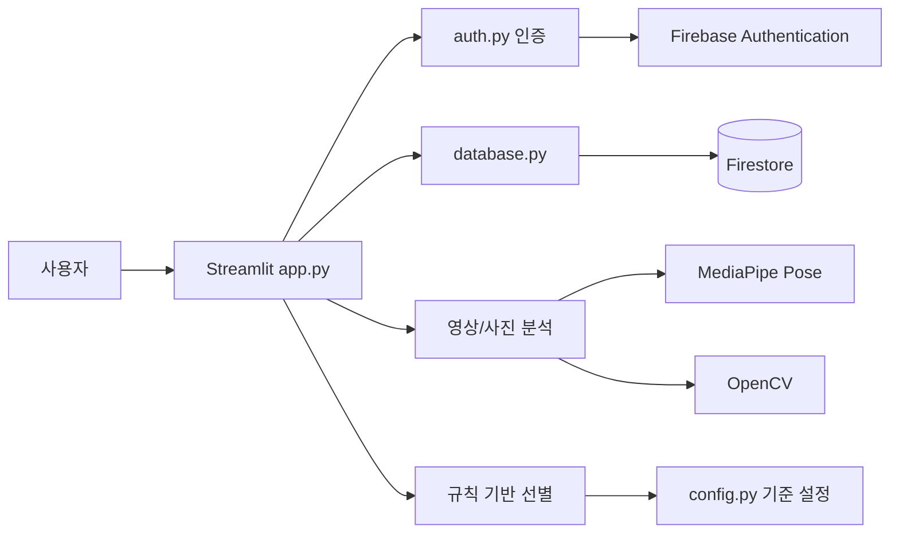
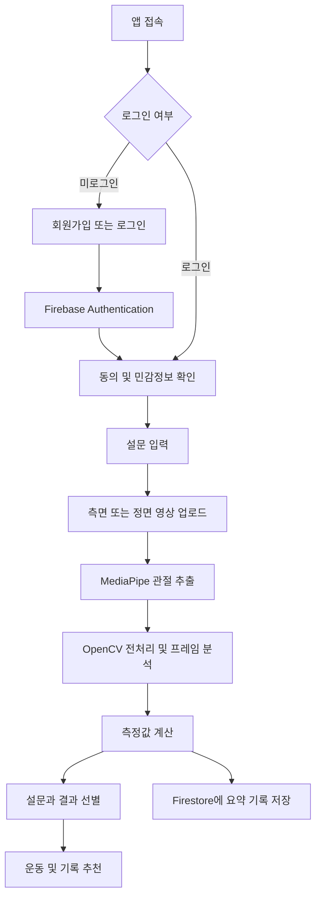
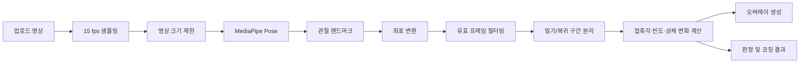
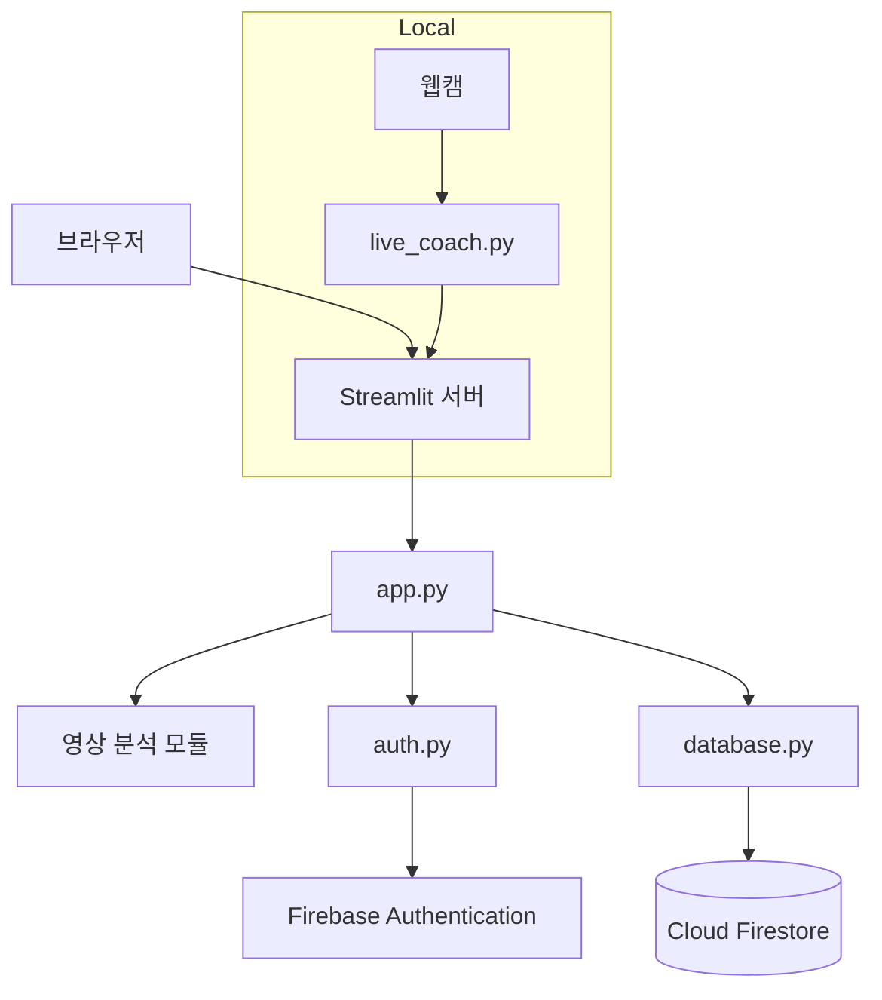

# Wheelance Architecture

## 1. 개요

Wheelance는 Streamlit 기반의 휠체어 자세 및 추진 동작 분석 웹앱입니다.
브라우저에서 입력과 결과 화면을 제공하고, 서버 측 Python 코드가 영상·사진을 분석합니다.

## 2. 전체 구조

### 2.1 프레젠테이션 계층

- `app.py`
  - Streamlit 앱 진입점
  - 로그인·동의·설문·측정·운동·기록 화면 구성
  - 업로드된 영상과 사진을 분석 모듈에 전달
  - 분석 결과를 사용자 화면과 구조화된 기록으로 변환
- `styles.py`
  - 모바일 UI와 공통 CSS 제공
- `components/`
  - 카메라 촬영 및 마네킹 시각화용 웹 컴포넌트
- `timer_component.py`
  - 체중 이동 안내 타이머

### 2.2 인증 계층

- `auth.py`
  - Firebase Authentication REST API 호출
  - 회원가입·로그인·토큰 갱신·세션 상태 관리
- `Streamlit Secrets`
  - Firebase 웹 API 키와 관리자 서비스 계정 설정 보관

### 2.3 데이터 계층

- `database.py`
  - Firebase Admin SDK를 통해 Firestore 접근
  - 사용자 문서와 각 분석 세션을 사용자 UID 아래에 저장
- 주요 컬렉션
  - `users/{uid}`: 사용자 정보·동의·프로필
  - `users/{uid}/propulsion_sessions`: 추진 분석 기록
  - `users/{uid}/posture_sessions`: 정지 자세 분석 기록
  - `users/{uid}/stretch_logs`: 운동 수행 기록
  - `users/{uid}/cva_checks`: 목 각도 비교 기록

원본 영상과 사진은 장기 저장하지 않고, 측정 수치와 필요한 요약 정보만 저장합니다.

### 2.4 분석 계층

- `pose_utils.py`
  - MediaPipe 초기화
  - 랜드마크 추출 및 좌표 변환
  - 각도·거리·스무딩 등 공통 계산
- `propulsion.py`
  - 측면·정면 추진 영상 분석
  - 프레임 필터링과 카메라 품질 확인
  - 밀기 구간과 복귀 구간 분리
  - 접촉 각도·추진 빈도·궤적 패턴 계산
- `posture.py`
  - 정지 자세 사진 분석
  - 휠체어 좌석선 또는 등받이선을 기준선으로 사용
- `live_coach.py`
  - 로컬 웹캠 실시간 코칭
  - 스켈레톤·손목 궤적·상체 기울기 표시
- `camera_check.py`
  - 촬영 거리·밝기·카메라 흔들림 등 기본 품질 확인
- `overlay.py`
  - 스켈레톤, 기준선, 궤적 등의 시각화

### 2.5 선별 및 콘텐츠 계층

- `screening.py`
  - 설문 답변과 영상 측정값을 종합
  - 몸·미는 기술·휠체어 세팅 확인 순서를 규칙 기반으로 제안
- `keywords.py`
  - 측정값과 설문을 운동 추천 키워드로 변환
- `config.py`
  - 판정 기준, 알고리즘 상수, 안내 문구와 운동 관련 설정
- `data/exercises.json`
  - 운동 목록과 운동별 안내 정보

선별 규칙은 임상적으로 검증된 진단법이 아니며 의료 진단을 대체하지 않습니다.

## 3. 주요 사용자 흐름

## 4. 분석 파이프라인

### 측면/정면 추진 영상

### 정지 자세 사진

## 5. 배포 구조

- 로컬 실행: 전체 기능 사용 가능
- Streamlit Community Cloud: 웹캠 실시간 코칭은 환경 제약으로 제한
- 의존 라이브러리: Streamlit, MediaPipe, OpenCV, NumPy, Firebase Admin

## 6. 보안 경계

- `.streamlit/secrets.toml`과 Firebase 서비스 계정 JSON은 소스 저장소에 포함하지 않습니다.
- `database.py`는 사용자 UID를 기준으로 사용자 하위 문서에만 접근합니다.
- 로그인 인증은 `auth.py`의 Firebase REST API를 사용합니다.
- 관리자 권한이 필요한 Firestore 접근은 서버 측에서만 수행됩니다.
- 앱은 원본 영상을 장기 저장하는 대신 결과 요약과 필요 시 전경을 흐린 자세 사진을 제한적으로 저장합니다.
